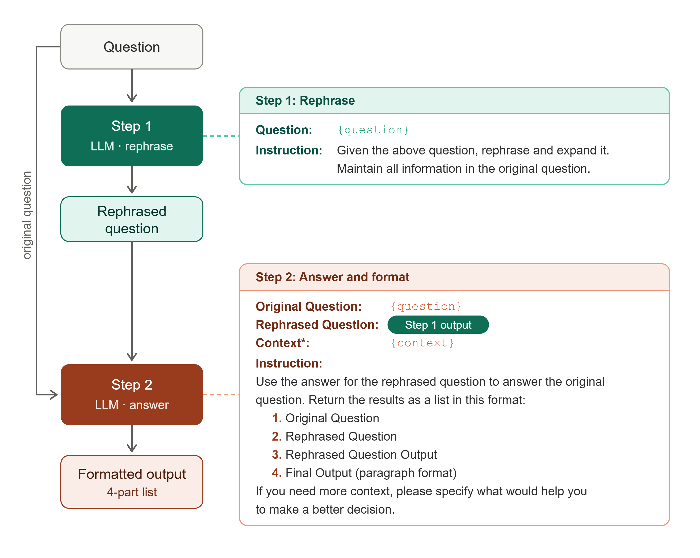

# Additional Information

This repository provides additional information and supporting materials associated with the research paper:

**Assess-Teach-Validate (ATV) Framework: A Structured Approach to Prompt Engineering for Exploring System Design with Large Language Model**

The materials presented here include figures, diagrams, and supplementary explanations that were not included in the submitted manuscript due to space limitations.

These materials are intended to provide further context and support the methodology, results, and discussion presented in the paper.

## Additional Figures

### Access-Teach-Validate Framework 

#### Prompt Template 1: Two-Step RaR

#### Prompt Template 2: CoVe

#### Prompt Template 2: Few-Shot CoT

### XML File Template

**Description:** [Brief description of the figure.]

## Related Publication

**Paper:** [Full Paper Title]  
**Authors:** [Author Names]  
**Publication:** [Conference/Journal, Year]  
**Link:** [DOI or Publication URL]
